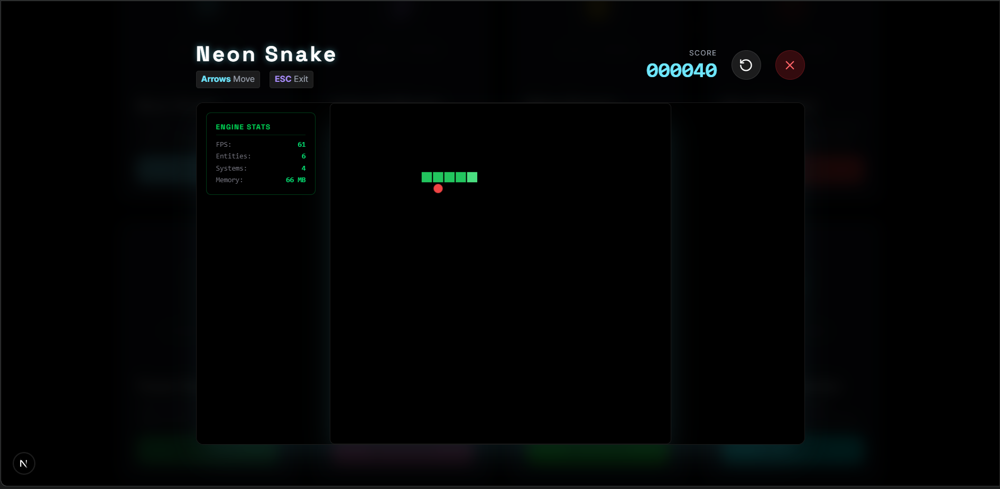
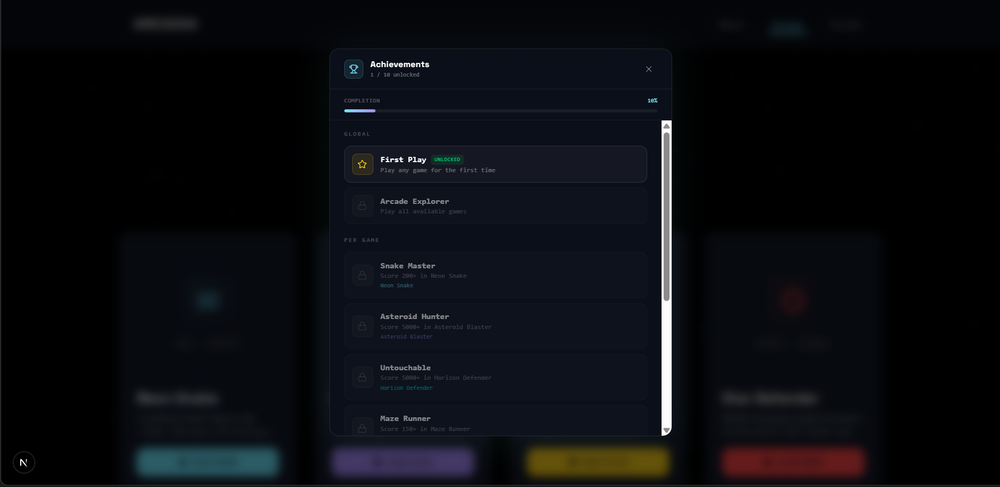
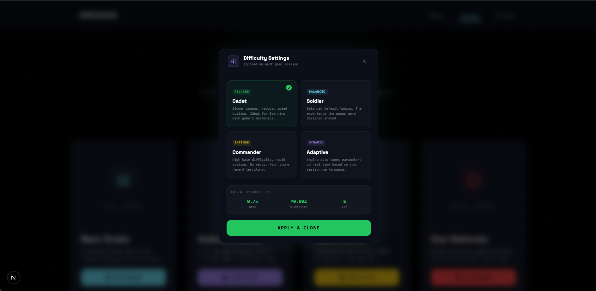

# ＡＲＣＡＤＩＡ ＰＲＯＴＯＣＯＬ

> _System Status:_ **ONLINE**
> _Build:_ `v3.0.0 — Neon Horizon`
> _Engine:_ `Custom ECS · TypeScript · Web-Native`
> _Network:_ [**>> INITIATE UPLINK (LIVE DEMO) <<**](https://arcadia-web-arcade.netlify.app/)

<p align="center">
  <a href="https://arcadia-web-arcade.netlify.app/" target="_blank">
    
  </a>
</p>

---

**Arcadia** is not a game. It is a statement.

A high-performance, browser-based arcade portal engineered from first principles — no Unity, no Unreal, no compromise. Twelve original titles, one custom-built game engine, and a singular question that drove every line of code:

> _How far can the browser actually go?_

This is the answer.

---

## ⚡ System Architecture

Arcadia runs on a bespoke engine built entirely in TypeScript, living in `/engine`. Transparent, modular, and ruthlessly optimized for the browser runtime. No black boxes. Every system is owned.

<p align="center">
  
</p>

### Engine Systems

| System                            | Role                                                                                                                                                                             |
| --------------------------------- | -------------------------------------------------------------------------------------------------------------------------------------------------------------------------------- |
| **Entity Component System (ECS)** | Data-oriented architecture. State (Components) is decoupled from behavior (Systems). Zero tight coupling. Infinite scalability.                                                  |
| **Deterministic Game Loop**       | Fixed-timestep `rAF` loop with elapsed-time accumulation. Physics output is identical at 60fps, 120fps, or any refresh rate — on any device.                                     |
| **Event Bus**                     | Fully decoupled pub/sub layer. Collisions, score deltas, state transitions — every signal is broadcast once and consumed by any subscriber. No god objects.                      |
| **Synthesized Audio Engine**      | A custom `SoundManager` generates every sound effect procedurally via the Web Audio API. Oscillators, filters, envelopes, reverb — computed at runtime. Zero audio files loaded. |
| **Dynamic Difficulty AI**         | A `DifficultyManager` continuously samples player performance metrics and adjusts spawn rates, entity velocities, and hazard density in real time. The game always pushes you.   |
| **Achievement Tracking**          | Seamless, robust global and game-specific achievement unlocking integrated into the core `ArcadeManager`.                                                                        |
| **Seeded Randomness**             | Deterministic PRNG means the same seed produces the same run every time. Foundation for future speedrun verification and replayable level generation.                            |
| **Particle System**               | Lightweight, pooled particle emitters for visual feedback (explosions, trails, impacts) with zero GC pressure. Object recycling over allocation.                                 |

---

## 📸 Interface & Metagame

Arcadia provides a full arcade experience built on modern web styling:

<p align="center">
  
</p>

### Feature Highlights

- **Dynamic Difficulty Settings**: Tune the engine's aggression before you play using the Difficulty Panel. Ranging from Cadet to Commander, or leave it on Adaptive to let the engine scale with your score.
- **Global & Game Achievements**: Unlock trophies for high scores and milestones.
- **Persistent Medals & Leaderboards**: Master games to earn Bronze, Silver, and Gold medals saved directly to your local profile.

<p align="center">
  
  
</p>

<p align="center">
  
</p>

---

## 🕹️ Active Modules — The Games

Twelve titles. Each one a different system stress-test. Each one built from scratch.

### 01 · NEON SNAKE `/games/snake`

> _A cybernetic reimagining._
> High-fidelity grid-based movement with reactive audio triggers, positional screen-shake, and particle effects on consumption. Deceptively simple. Ruthlessly precise.

### 02 · ASTEROID BLASTER `/games/asteroids`

> _The void does not forgive._
> Full Newtonian physics simulation. Polygon collision detection, asteroid splitting mechanics, weapon heat management, and true inertial movement. No friction. No mercy.

### 03 · MAZE RUNNER `/games/maze-runner`

> _Navigate the dark. Collect the light._
> Procedurally generated neon labyrinths. Energy orb collection, timed hazards, and escalating complexity. The path is never the same twice.

### 04 · STAR DEFENDER `/games/star-defender`

> _The last line._
> Wave-based galactic defense. Alien formations, projectile management, and relentless incoming fire. Hold your position or lose everything.

### 05 · TOWER ESCAPE `/games/tower-escape`

> _Up is survival._
> Vertical platforming with an ever-rising floor. Enemy density, timed hazard gaps, and split-second decision windows on every platform.

### 06 · RIVER DASH `/games/river-dash`

> _Flow or die._
> Precision navigation through a physics-driven river system. Momentum-based control means overcorrecting is a death sentence.

### 07 · NEON SWARM `/games/neon-swarm`

> _They are everywhere._
> Emergent flocking AI. High-density enemy swarms with genuine behavioral patterns, overwhelming numbers, and shrinking survival windows.

### 08 · HORIZON DEFENDER `/games/horizon-defender`

> _Hold the line._
> Lateral defense with escalating threat vectors, resource pressure, and no timeout. You hold until you don't.

### 09 · PRISM BREAK `/games/prism-break`

> _Shatter the wall._
> Paddle reflection mechanics with colored glowing bricks, dynamic angle control, and a ball that speeds up as the level progresses.

### 10 · VOID CHOMP `/games/void-chomp`

> _Consume and evade._
> Grid-based dot collection while evading seeking drones. Drone tracking AI scales directly with core engine difficulty.

### 11 · STACK PANIC `/games/stack-panic`

> _Clear the line._
> Falling tetromino block placement with rotation, ghost previews, hard drops, and exponential speed scaling.

### 12 · BOUNCE BLITZ `/games/bounce-blitz`

> _The ultimate duel._
> High-speed 1v1 paddle duel against a calculating AI. Predict the bounce, outmaneuver the algorithm.

---

## 🚀 Getting Started

Access the live terminal immediately:
> **[>> ENTER THE ONLINE PORTAL <<](https://arcadia-web-arcade.netlify.app/)**

Or boot the Arcadia protocol locally in three steps:

```bash
# 1. Acquire dependencies
npm install

# 2. Ignite the development server
npm run dev

# 3. Enter the portal
open http://localhost:3000
```

The engine initializes all subsystems on first load. No compilation pipeline. No external runtime. No install required beyond Node. Pure web.

---

## 🔧 Stack

| Layer           | Technology                                    |
| --------------- | --------------------------------------------- |
| **Framework**   | Next.js 15 (App Router)                       |
| **Language**    | TypeScript — strict mode, no implicit any     |
| **Rendering**   | HTML5 Canvas API                              |
| **Animations**  | Framer Motion                                 |
| **Styling**     | Tailwind CSS v4                               |
| **Audio**       | Web Audio API (synthesized, zero asset files) |
| **Game Engine** | Custom ECS — zero third-party game libraries  |

---

## 👾 The Architect

<p align="center">
  
</p>

**Ram Sharma** — _Creator & Lead Engineer_

Arcadia is not a side project. It is a technical statement — proof that the open web is a first-class platform for high-performance interactive software.

Built by a developer obsessed with the craft of software, the physics of interaction, and the question that will not stop: _how far can the browser actually go?_ Arcadia is the answer, committed one system at a time.

- 🔗 **GitHub:** [github.com/sharmaram25](https://github.com/sharmaram25)
- 💼 **LinkedIn:** [linkedin.com/in/ram-sharma-20rs02](https://www.linkedin.com/in/ram-sharma-20rs02)
- 📧 **Email:** [sharmaram2504@gmail.com](mailto:sharmaram2504@gmail.com)

---

> _"The screen is a canvas. Code is the paint. And the browser has always been capable of more than you think."_

```
© 2025 Ram Sharma — All systems operational.
```
